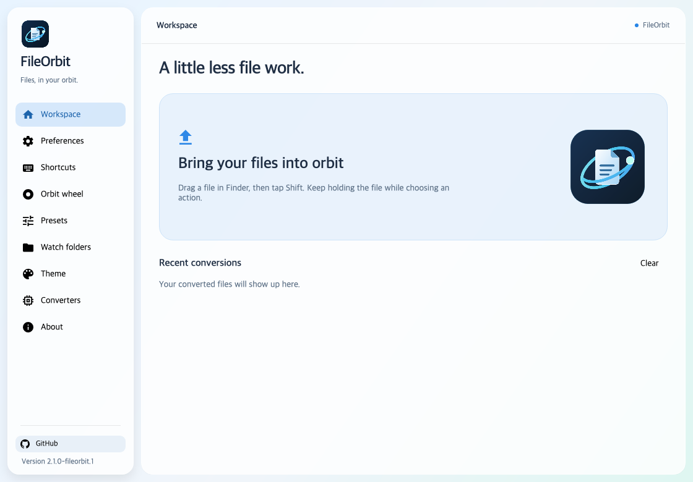

# FileOrbit

**Files, in your orbit.**

An offline file-conversion workspace with a glass-style interface, contextual radial tools, and native desktop integration.



## Download

[Preview releases](https://github.com/julanom/FileOrbit/releases) · [Report a bug](https://github.com/julanom/FileOrbit/issues)

| Platform | Package | Status |
| --- | --- | --- |
| macOS 13+ | Apple Silicon and Intel ZIP | Ad-hoc signed; not notarized |
| Windows 10/11 | x64 portable ZIP | Unsigned preview |
| Linux | x64 and ARM64 tar.gz | Ubuntu 24.04+ preview |

Each release includes SHA-256 checksums. Packages include the .NET runtime, rhwp, and 7-Zip; additional converters are installed from the app.

## Use it

Drop files into the workspace, or use a configured drag shortcut to open the orbit wheel without dropping. On macOS, the defaults are:

- **Shift**: conversions
- **Command**: tools
- **Control**: file actions
- **Tab / scroll**: flip to the other wheel face, when available

Keep holding the file as you choose an operation. Grant Accessibility access on macOS; replacing the app may require re-enabling it. The wheel retains the all-Spaces overlay implementation.

Windows and Linux shortcuts are configurable. Linux global gestures work best on X11; Wayland support is experimental and compositor-dependent. In-app drag and conversion remain available.

Windows uses the classic Explorer menu (under “Show more options” on Windows 11); a separately signed modern shell extension is not included.

## Features

- Image, document, archive, audio, video, and other format conversions, depending on available engines.
- Interactive crop, rotate/flip, PDF tools, file shelf, copy/move, and platform-specific actions.
- Watch folders, reusable presets, searchable conversion history, and customizable wheel layouts.
- System fonts, light/dark glass-style surfaces, native window controls, and opaque fallbacks where desktop blur is unavailable.
- Ten interface languages. Legal notices remain available in About.

## Build

Install the .NET 10 SDK.

```sh
dotnet build src/Filee.App -c Release
dotnet run --project src/Filee.App
```

macOS: `sh build/build-fileorbit-macos.sh Releases`

Windows PowerShell: `./build/build-fileorbit-windows.ps1`

Linux PowerShell: `./build/build-portable.ps1 -Runtime linux-x64 -SkipFonts`

The package workflow builds on each target OS. Tags publish a preview only after all package jobs pass. Internal assembly and namespace names retain compatibility with the conversion engine; the public application identity is FileOrbit.

## Verification and limitations

Focused regression tests cover native-drag precedence, duplicate wheel entries, wheel actions/flipping, and light/dark/RTL rendering. No claim is made that all formats or desktop environments are tested. Optional converters can have platform-specific restrictions. See [release notes](docs/RELEASE-NOTES.md).

## License and acknowledgments

MIT. FileOrbit derives from Filee; the original copyright and permission notice remains in [LICENSE](LICENSE), with dependency licenses in [THIRD-PARTY-NOTICES.md](THIRD-PARTY-NOTICES.md). Product branding and support links are FileOrbit's; this is not an upstream release.
